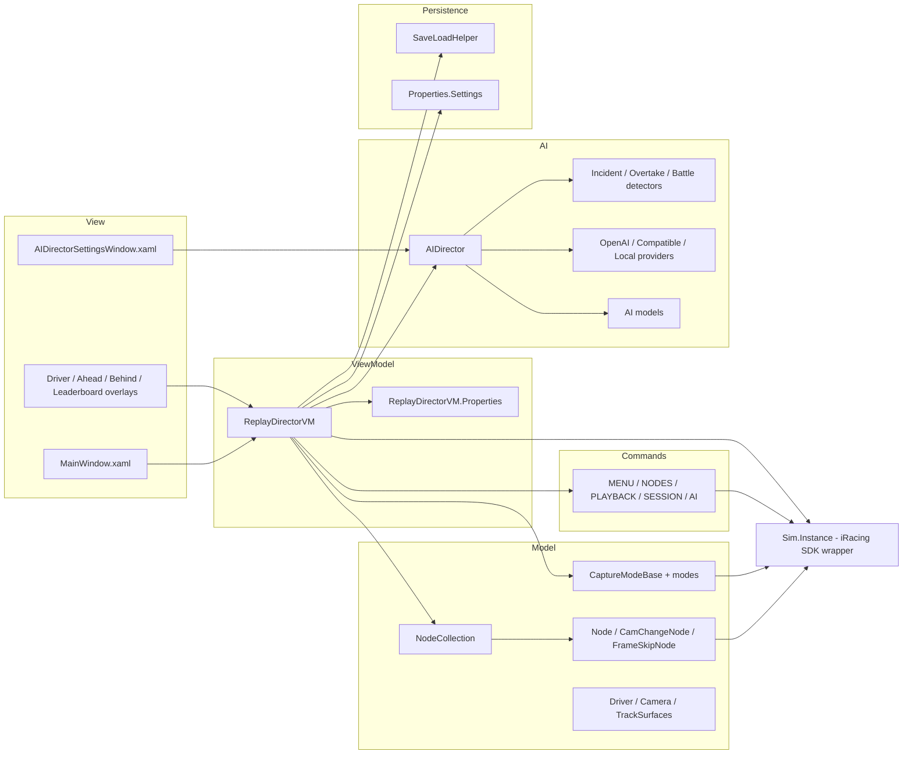
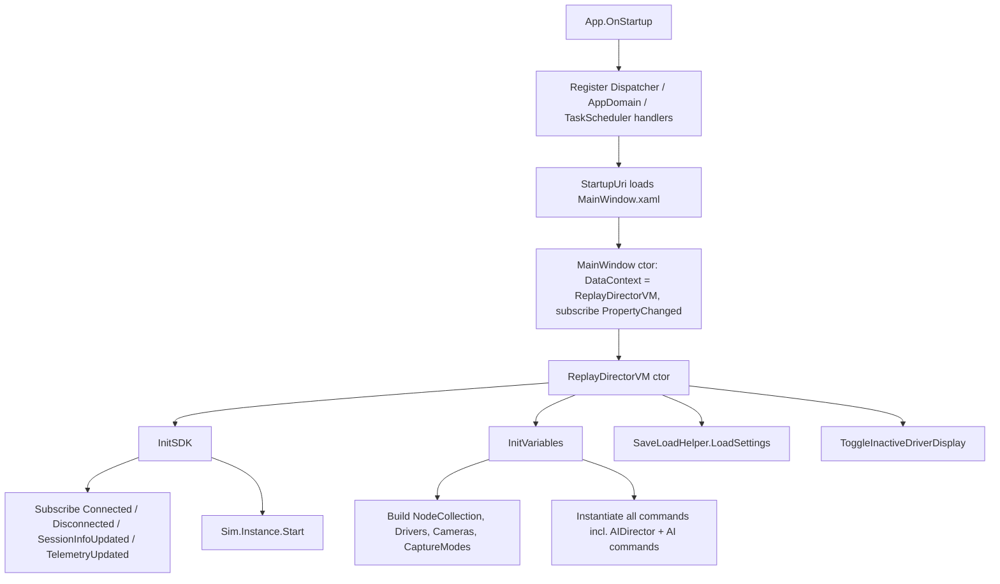
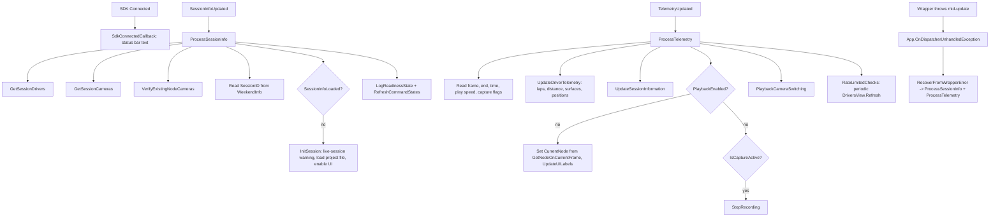
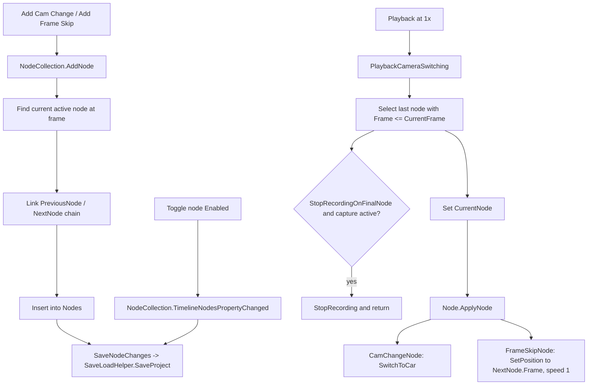
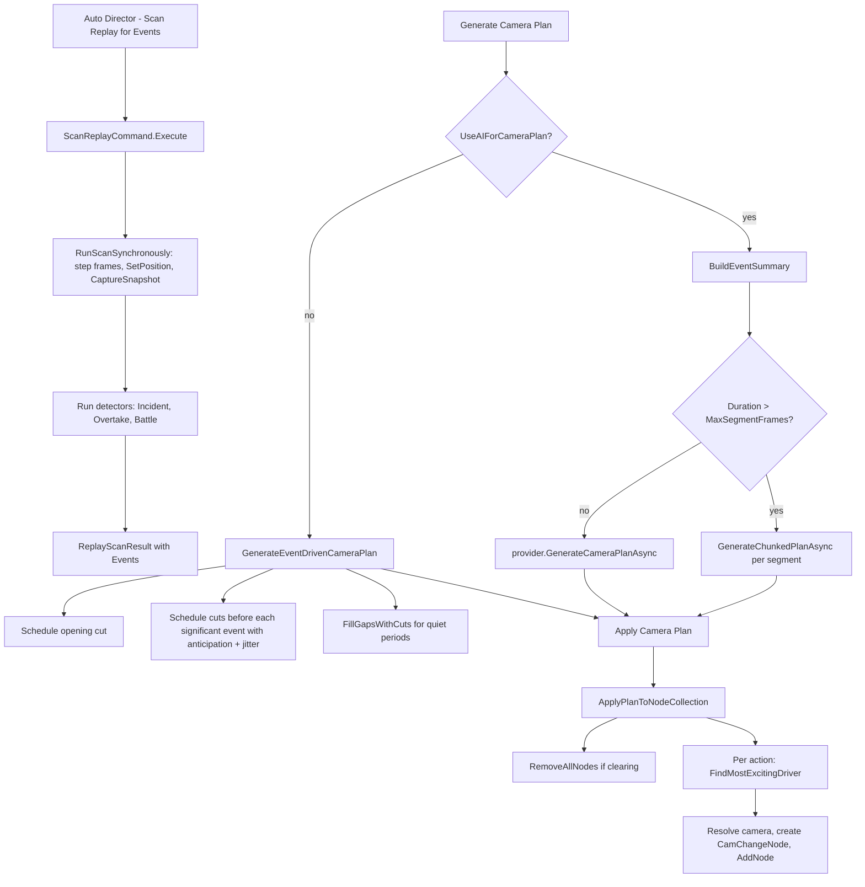
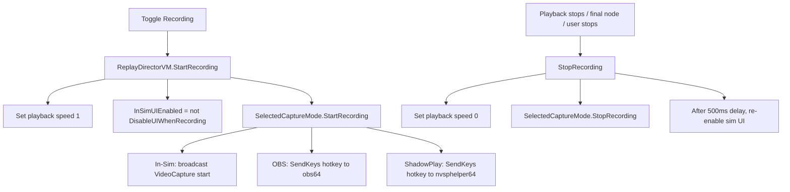
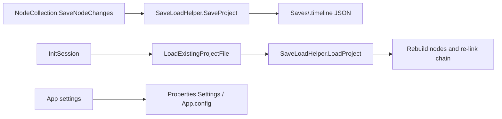
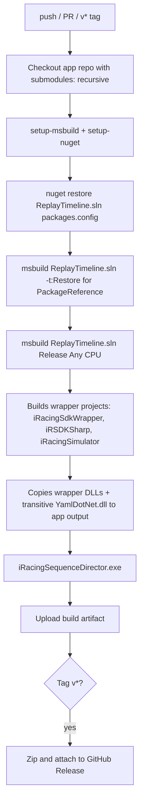

# Code Flow Map - iRacing Automated Replay Director

This document maps the runtime flow of the application. It complements
[`AUDIT.md`](AUDIT.md) (findings) and the architecture notes in
[`CLAUDE.md`](../CLAUDE.md).

Companion documents:
- [`plans/build-ci-and-code-audit-plan.md`](../plans/build-ci-and-code-audit-plan.md) - build/CI plan
- [`AUDIT.md`](AUDIT.md) - code audit findings

---

## 1. High-level component map



---

## 2. Application startup and SDK connection



---

## 3. Session info and telemetry pipeline



---

## 4. Timeline node editing and playback application



---

## 5. Auto Director pipeline



### 5.1 Driver selection scoring (summary)

When applying a plan, `FindMostExcitingDriver` scores each active driver per cut:

```
ActionScore  = EventProximity + Momentum + ActiveBattle + PackProximity + FreshAction
PositionScore = baseline interest from running position
VarietyPenalty = penalty for recently shown drivers, dampened by action level
FinalScore = ActionScore + (PositionScore * (1 - ActionLevel * 0.5))
             - (VarietyPenalty * VarietyDampener) - OverexposurePenalty + DiversityBonus
```

Weights are configurable in `AIDirectorSettings` (see the README tuning guide).

---

## 6. Recording / capture flow



---

## 7. Persistence



---

## 8. GitHub Actions auto-build flow

The iRacing SDK wrapper is a git submodule at `external/iRacingSdkWrapper`
(source `rockavoldy/iRacingSdkWrapper`) and is built as part of the solution via
`ProjectReference`, so there is no separate wrapper checkout or build step. Its projects
are SDK-style (`net48`), so the workflow restores both `packages.config` and
`PackageReference` before building.


