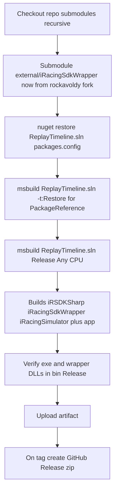

# Plan: Switch iRacingSdkWrapper submodule to the rockavoldy fork and make CI compile

Project: **iRacing Automated Replay Director** (`ReplayTimeline.sln` / `ReplayTimeline/ReplayTimeline.csproj`)
WPF / .NET Framework 4.8, root namespace `iRacingReplayDirector`.

## Goal

Use the fork `github.com/rockavoldy/iRacingSdkWrapper` (which carries the three wrapper
projects) instead of `NickThissen/iRacingSdkWrapper`, and guarantee that GitHub Actions can
compile the solution end to end.

## Verified current state

- The wrapper is a **git submodule** at `external/iRacingSdkWrapper`; the app consumes it via
  `ProjectReference` in [`ReplayTimeline.csproj`](../ReplayTimeline/ReplayTimeline.csproj:55).
  The submodule **path is unchanged** when the remote changes, so no `.csproj`/`.sln` path edits
  are required.
- Only two places point at the old remote: [`.gitmodules`](../.gitmodules:1) (committed) and the
  local `.git/config` (not committed).
- Wrapper projects currently target legacy frameworks: `v4.0` for
  [`iRSDKSharp.csproj`](../external/iRacingSdkWrapper/irsdkSharp/iRSDKSharp.csproj:13) and
  [`iRacingSdkWrapper.csproj`](../external/iRacingSdkWrapper/iRacingSdkWrapper/iRacingSdkWrapper.csproj:13),
  `v4.5.1` for [`iRacingSimulator.csproj`](../external/iRacingSdkWrapper/iRacingSimulator/iRacingSimulator.csproj:12).
- CI works around the missing legacy reference assemblies on `windows-latest` with a
  **retarget step** in [`.github/workflows/build.yml`](../.github/workflows/build.yml:53).
- `YamlDotNet` is a transitive dependency of `iRacingSdkWrapper` via
  [`packages.config`](../external/iRacingSdkWrapper/iRacingSdkWrapper/packages.config:3) with the
  DLL committed in the submodule `packages` folder; only `Newtonsoft.Json` is NuGet-restorable for
  the app ([`packages.config`](../ReplayTimeline/packages.config:3)).
- Documentation still names `NickThissen/iRacingSdkWrapper` in
  [`CLAUDE.md`](../CLAUDE.md:33), [`README.md`](../README.md:300), [`docs/AUDIT.md`](../docs/AUDIT.md:19),
  [`docs/FLOW.md`](../docs/FLOW.md:234), and the
  [`ReplayTimeline.csproj`](../ReplayTimeline/ReplayTimeline.csproj:19) comment.

## Target CI flow

> **Outcome (implemented):** the fork's `master` is a modernized, SDK-style wrapper that
> targets `net48` (`iRSDKSharp` also `netstandard2.0`) and restores its dependencies via
> `PackageReference`. The app was therefore retargeted `net472` -> `net48`, the obsolete CI
> retarget step was removed, and CI now runs both `nuget restore` and `msbuild -t:Restore`.

## Steps

1. **Inspect the fork.** Confirm the branch, that it contains `iRSDKSharp`, `iRacingSdkWrapper`
   and `iRacingSimulator`, their `TargetFrameworkVersion`, the `YamlDotNet` reference/hint path,
   and that the `packages` folder (with `YamlDotNet.dll`) is present.
2. **Repoint the submodule.** Set the URL to `https://github.com/rockavoldy/iRacingSdkWrapper.git`
   in `.gitmodules`, run `git submodule sync`, then `git submodule update --init --recursive` so
   `external/iRacingSdkWrapper` tracks a fork commit.
3. **Commit** the updated `.gitmodules` and the new submodule gitlink.
4. **Decide the CI retarget step.** If the fork's three projects are already `v4.7.2`, remove the
   `Retarget submodule projects to .NET Framework 4.7.2` step; otherwise keep it as a guarded
   fallback so CI still builds either way.
5. **Update the workflow** header/step comments and any cache paths in
   `.github/workflows/build.yml` to reference the rockavoldy fork.
6. **Update documentation** references from `NickThissen` to `rockavoldy` in `CLAUDE.md`,
   `README.md`, `docs/AUDIT.md`, `docs/FLOW.md`, and the `ReplayTimeline.csproj` comment.
7. **Validate the CI build** on `windows-latest`: submodule checks out, `nuget restore` succeeds,
   `msbuild ReplayTimeline.sln /p:Configuration=Release /p:Platform="Any CPU"` produces
   `ReplayTimeline/bin/Release/iRacingSequenceDirector.exe` plus
   `iRacingSdkWrapper.dll`, `iRacingSimulator.dll`, `iRSDKSharp.dll`, `YamlDotNet.dll`,
   `Newtonsoft.Json.dll`, and the artifact uploads.
8. **Validate the release job** produces the zip asset on a `v*` tag.

## Risks / open questions

- The fork must contain the same three projects at the same relative paths
  (`iRacingSdkWrapper/`, `iRSDKSharp/` as `irsdkSharp/`, `iRacingSimulator/`) or the `ProjectReference`
  paths in `ReplayTimeline.csproj` and the `.sln` will break.
- If the fork is not retargeted, the CI retarget step must stay.
- Submodule commits are resolved by the gitlink; changing the remote does not change the pinned
  commit, so the pinned SHA must exist on the fork.
